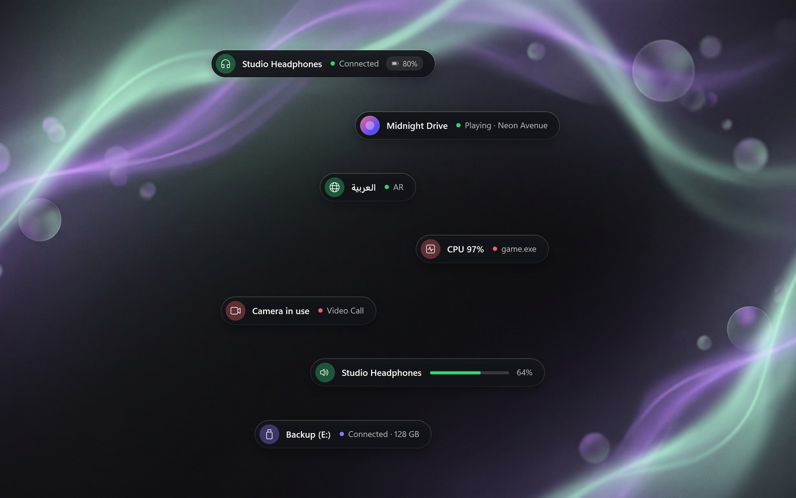
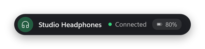
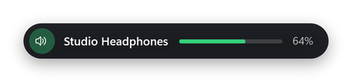
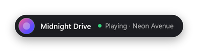
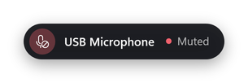
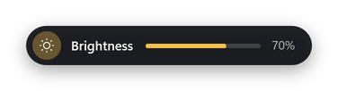
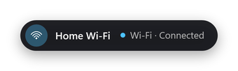
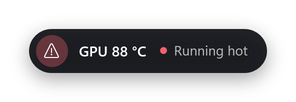
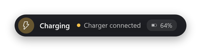

<p align="center">
  
</p>

<p align="center">
  <b>A modern HUD for Windows 11.</b> One clean, animated pill for your headphones, controllers, volume, mic,
  music, keyboard language, network and system health. It also moves your sound to your headphones the moment they connect.
</p>

<p align="center">
  <a href="../../releases/latest"><b>Download for Windows</b></a> ·
  <a href="#features">Features</a> ·
  <a href="#light-on-your-pc">Light on your PC</a> ·
  <a href="#privacy-and-security">Privacy</a> ·
  <a href="#build-from-source">Build</a>
</p>

---

<p align="center">
  
</p>

<p align="center">
  
</p>

## Why

Windows tells you very little when a device connects. Bluetooth headphones pair silently and the sound often keeps
playing from your speakers. A controller connects with no feedback at all. The volume pop-up is large and sits in a
corner. Capsule replaces all of that with one small, consistent HUD. The icon appears first, the pill glides open
from the middle, then closes back the same way. It never steals focus from your game, and clicks pass right through it.

## Features

### Devices and sound

| | |
|---|---|
|  | **Headphones**: sound (and calls, if you like) moves to your headphones as soon as they connect, and back when they leave. Shows battery when the headphones report it. |
|  | **Game controllers**: USB and Bluetooth, with battery. Steam Input's virtual controllers are ignored. |
|  | **Volume and mute**: a slim level bar for the device that's actually playing. |
|  | **Now playing**: song, artist and album art when music starts, pauses or skips. |
|  | **Microphone mute**: never wonder if you're muted on a call. |
|  | **USB drives**: name and size when a drive connects or is removed. |
|  | **Camera and mic in use**: a privacy heads-up naming the app that started recording. |

### Keyboard, screen and network

| | |
|---|---|
|  | **Keyboard language**: shows the new language when you switch (English ⇄ العربية and more). |
|  | **Caps Lock / Num Lock**: on or off at a glance. |
|  | **Screen brightness** on laptops and tablets. |
|  | **Network**: Wi-Fi or Ethernet connected, internet lost, VPN on or off. |

### System health (only when it lasts, never for short spikes)

| | |
|---|---|
|  | **Busy CPU or GPU**: above 90% for 30 seconds, naming the app responsible. |
|  | **Heat**: GPU over 85 °C (any brand), or Windows slowing the CPU down because of heat. |
|  | **Battery and charger**: plugged in or unplugged, laptop battery low, headphones or controller battery low. |
| | **Memory and disk**: memory over 90%, or a drive under 10 GB free. |

### Everything else

- **Keeps your microphone.** When Bluetooth headphones connect, Windows often switches to the headset's mic, which
  drops the headphones to low "call quality" sound. Capsule keeps your usual mic, or one you choose.
- **Rename your devices** ("My headphones" instead of a model number) for the HUD and tray menu.
- **Make it yours:** position (click a spot on the screen), which monitor, size, dark / light / same-as-Windows,
  six accent colours and how long it stays. A live preview updates as you change things.
- **Replaces the Windows volume pop-up** *(experimental)*, so only Capsule shows.
- **Updates itself, with your permission.** Once a day Capsule checks GitHub for a new version and asks before installing.
- **Light and dark settings window**, or the same as Windows.

<p align="center">
  
</p>

## Light on your PC

Capsule is built to be invisible in Task Manager:

- **Waits instead of watching.** Almost everything is event-driven: Windows tells Capsule when a device, the volume,
  the network or the camera changes. System health is sampled every few seconds, with the heavier GPU reading every 15 seconds.
- **Windows Efficiency mode** (the green leaf in Task Manager) and below-normal priority, so it never competes with your games.
- **Draws on your GPU.** The pill is rendered once and kept on the graphics card while it is on screen. When it's
  hidden, nothing is drawn at all.
- **Pauses while your PC is locked**, and hands memory back after start-up and when you close the settings window.

Measured on a Windows 11 desktop at idle: about **20 MB of memory in use** and **under 1% of one CPU core**.

## Install

1. Download `Capsule-win-x64.exe` (or `Capsule-win-arm64.exe` for Arm PCs) from the
   [latest release](../../releases/latest).
2. Put it somewhere permanent, for example `%LOCALAPPDATA%\Programs\Capsule\`, and run it.
3. The settings window opens the first time. Turn on **Start with Windows** under *General* and you're done.
   Capsule lives in the notification area: left-click its icon for settings, right-click for the quick menu.

No installer, no admin rights, and the defaults work for most headphones.

> **SmartScreen:** Capsule isn't code-signed yet, so Windows may show "Windows protected your PC" the first time.
> Choose **More info → Run anyway**, or [verify the download](SECURITY.md#verifying-a-download) first.

To uninstall, turn off **Start with Windows**, quit Capsule from the tray menu, and delete the exe and
`%APPDATA%\Capsule`.

## Privacy and security

- **Nothing about you leaves your PC.** No telemetry, analytics or accounts. The only connection Capsule ever makes
  is the daily update check to GitHub (`api.github.com`), which you can turn off. Updates are downloaded only after you
  say yes, and their SHA-256 checksum is verified before they're installed.
- **No admin rights.** It runs as you, with no service, driver or scheduled task.
- **No keyboard logging.** The lock-key and language HUDs only read whether Caps Lock / Num Lock are on and which
  keyboard language is active. Capsule never sees what you type.
- **Camera and mic alerts** read Windows' own privacy records (the ones shown in Settings → Privacy). Capsule never
  opens your camera or microphone.
- Settings are a small JSON file in `%APPDATA%\Capsule`. The log is in `%LOCALAPPDATA%\Capsule`.
- Releases are built by GitHub Actions from the tagged source, with SHA-256 sums and signed build provenance.
  Before the first release, the code went through a security audit with Cloudflare's open-source
  [security-audit skill](https://github.com/cloudflare/security-audit-skill), and every lead it raised was fixed.

See [SECURITY.md](SECURITY.md) for details and how to report a vulnerability.

## FAQ

**Does it work in games?** Yes in borderless / windowed-fullscreen games. Exclusive fullscreen draws over
every other window, including Capsule (and the Windows pop-ups too).

**My headphones aren't detected.** Settings → *Sound* → *Which headphones count* → *Only the ones I pick*, and tick them.

**I don't want calls to move to my headphones.** Turn off *Calls follow too* under *Sound*.

**Why no CPU temperature?** Windows doesn't let normal apps read it. Tools that show it install a kernel driver, which
Capsule deliberately avoids. Capsule tells you instead when Windows slows the CPU down because of heat, and shows the
GPU temperature, which Windows does provide.

**The Windows volume pop-up still shows.** The hide option is experimental because Windows has no official setting for
it. The very first change after Capsule starts can still flash the Windows pop-up.

## Build from source

Requires Windows 10 (19041) or later and the [.NET 10 SDK](https://dotnet.microsoft.com/download).

```powershell
git clone https://github.com/ahmedot/capsule-hud.git
cd capsule-hud
dotnet test Capsule.slnx
dotnet run --project src/Capsule
```

Single-file release build:

```powershell
dotnet publish src/Capsule -c Release -r win-x64 --self-contained -p:PublishSingleFile=true -p:IncludeNativeLibrariesForSelfExtract=true -o out
```

Useful switches: `Capsule.exe --quit` closes a running copy cleanly, and `Capsule.exe --snapshot <folder>`
renders every HUD pill, the animation frames and each settings page with sample device names.

### How it works

| Part | Windows API |
|---|---|
| Device connect / disconnect, default device | Core Audio `IMMNotificationClient` + `IPolicyConfig` |
| Volume and mic mute | `IAudioEndpointVolume` callbacks |
| Battery level | `Windows.Devices.Enumeration` (Bluetooth battery property) |
| Controllers | `Windows.Gaming.Input.RawGameController` |
| Now playing | `Windows.Media.Control` |
| Keyboard language, lock keys | `GetKeyboardLayout`, `GetKeyState` |
| Camera / mic in use | Windows privacy records (`CapabilityAccessManager`), with registry change notifications |
| USB drives, brightness | WMI `Win32_VolumeChangeEvent`, `WmiMonitorBrightnessEvent` |
| Network | `Windows.Networking.Connectivity` |
| CPU, GPU, memory, heat | `GetSystemTimes`, PDH counters, `D3DKMTQueryAdapterInfo`, `GlobalMemoryStatusEx` |
| HUD | WPF layered, click-through, no-activate window; GPU-cached; per-monitor DPI aware |
| Settings | WPF with the Windows 11 (Fluent) theme |

## License

[MIT](LICENSE)
