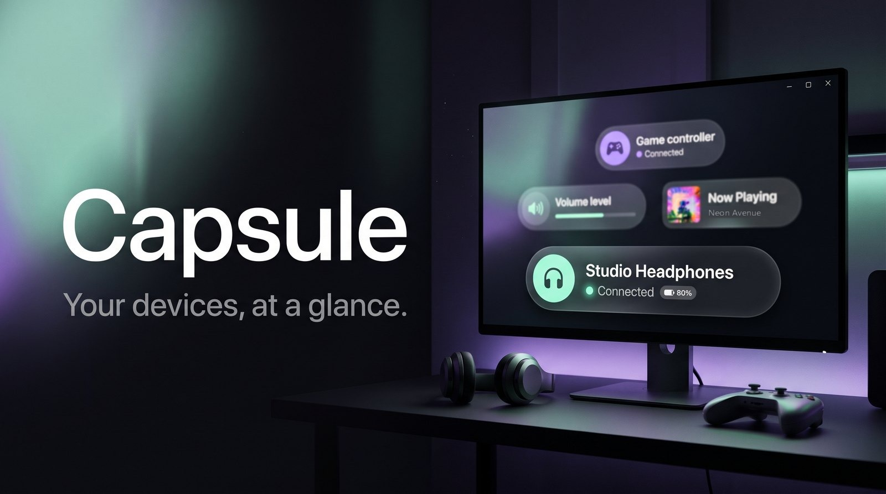
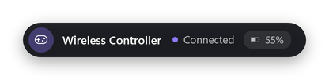
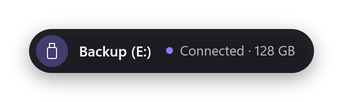
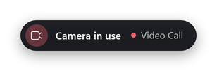
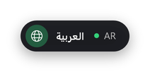
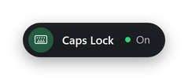
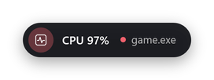
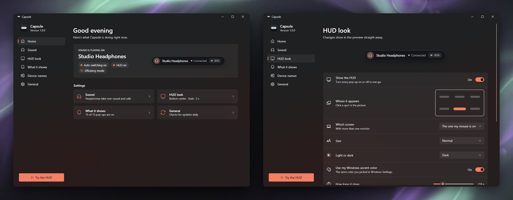
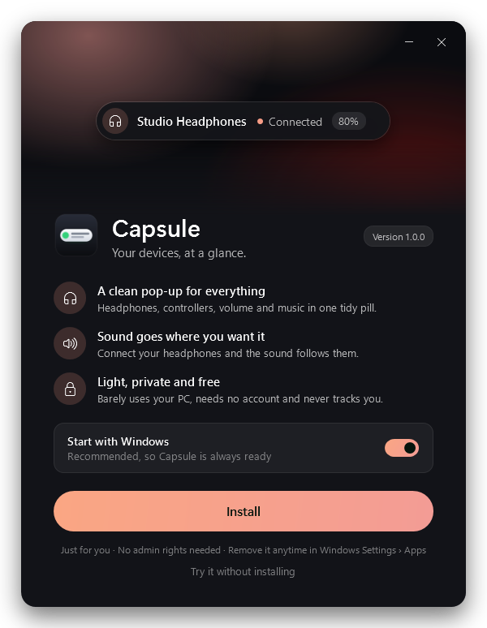
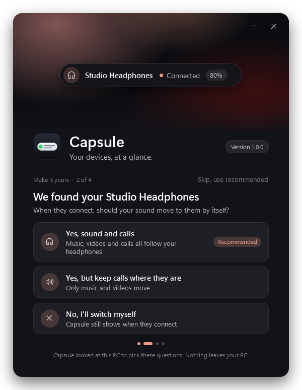

<p align="center">
  
</p>

<h3 align="center">A clean, friendly pop-up for Windows 11 that shows your headphones, controllers, volume, music and more.</h3>

<p align="center">
  <a href="https://github.com/ahmedot/capsule-hud/releases/latest/download/Capsule-Setup.exe"></a>
</p>

<p align="center"><sub>Free and open source · For Windows 11 · No account, no ads, no tracking</sub></p>

### Install in three steps

1. Click **Download for Windows** above.
2. Open **Capsule-Setup.exe** from your downloads.
3. Click **Install**, then answer a few one-tap questions about your PC (or tap **Skip**). That's it. Capsule starts
   straight away and pops up when you connect headphones, change the volume and more.

> **Seeing a warning?** Capsule is new and isn't code-signed yet, so your browser and Windows don't know it yet. If
> your browser says the file isn't commonly downloaded, choose **Keep** (in Edge it's under **⋯**). If Windows says
> "Windows protected your PC", click **More info**, then **Run anyway**. To check that the file is genuine, see
> [verifying a download](SECURITY.md#verifying-a-download).

<p align="center">
  <a href="#features">Features</a> ·
  <a href="#light-on-your-pc">Light on your PC</a> ·
  <a href="#privacy-and-security">Privacy</a> ·
  <a href="#faq">Questions</a> ·
  <a href="#build-from-source">Build</a>
</p>

---

<p align="center">
  
</p>

<p align="center">
  
</p>

## Why

Windows tells you very little when a device connects. Bluetooth headphones pair silently and the sound often keeps
playing from your speakers. A controller connects with no feedback at all. Capsule gives all of that one small,
consistent pop-up (the HUD) and takes over from the Windows volume pop-up too. The icon appears first, the pill glides
open from the middle, then closes back the same way. It never steals focus from your game, and clicks pass right
through it.

## Features

### Devices and sound

| | |
|---|---|
|  | **Headphones**: sound and calls move to your headphones as soon as they connect, and back when they leave (you can keep calls where they are). Shows battery when the headphones report it. |
|  | **Game controllers**: USB and Bluetooth, with battery when the controller reports it. Steam Input's virtual controllers are ignored (this also hides controllers made by Valve; turn it off under *Device names*). |
|  | **Volume and mute**: a slim level bar for the device that's actually playing. The pill keeps the same size at every level. |
|  | **Now playing**: song, artist and album art when music starts, pauses or skips. |
|  | **Microphone mute**: shows when your microphone is muted or unmuted in Windows, for example with a mute key on your keyboard or headset. (Mute buttons inside call apps don't change it.) |
|  | **USB drives**: name and size when a drive connects, and its name when it's removed. |
|  | **Camera or mic in use**: a privacy heads-up naming the app that starts (and stops) using your camera or microphone. |

### Keyboard, screen and network

| | |
|---|---|
|  | **Keyboard language**: shows the new language when you switch (English ⇄ العربية and more). |
|  | **Caps Lock / Num Lock**: on or off at a glance. |
|  | **Screen brightness** on laptops and tablets. |
|  | **Network**: Wi-Fi or Ethernet connected, internet lost, VPN on or off. |

### System health

| | |
|---|---|
|  | **Busy CPU or GPU**: CPU at 90% or GPU at 95% for 30 seconds (short spikes are ignored), naming the app responsible. |
|  | **Heat**: GPU at 85 °C or hotter for 10 seconds (any brand whose driver reports its temperature to Windows), or Windows slowing the CPU down because of heat. |
|  | **Battery and charger**: plugged in or unplugged, laptop battery at 20% and 10%, headphones or controller battery at 15%. |
| | **Memory and disk**: memory 90% full for 30 seconds, or a drive larger than 32 GB (USB sticks are skipped) with less than 10 GB free. |

### Everything else

- **Keeps your microphone.** When Bluetooth headphones connect, Windows often switches to the headset's mic, which
  drops the headphones to low "call quality" sound. Capsule keeps your usual mic, or one you choose (while
  *Switch to headphones automatically* is on).
- **Rename your devices** ("My headphones" instead of a model number) for the HUD and Capsule's menu.
- **Make it yours:** position (one of six spots: top or bottom, left, center or right), which monitor, size, dark /
  light / same-as-Windows and how long it stays. It uses your Windows accent color, or switch that off to pick one of
  six colors. A live preview updates as you change things.
- **Replaces the Windows volume pop-up** *(experimental, on by default)*, so only Capsule shows. Turn it off under
  *HUD look* if you prefer the Windows one. If you switch Capsule's volume pop-up off, the Windows one comes back.
- **No double pop-ups from keyboard apps.** Logi Options+ shows its own Caps Lock pop-up. Capsule hides that
  duplicate right after you press Caps Lock or Num Lock, and leaves the app's other alerts alone.
  Still see one from another app? **Teach Capsule** (in *HUD look*): press the key, Capsule names the app, and on
  your **Yes** it hides that app's pop-up too.
- **One color rule.** Your accent color means on, connected or playing; soft gray means off, disconnected, muted or
  paused; red is only for real warnings, such as heat, low battery, no internet or the camera and mic privacy alert.
- **Updates itself, with your permission.** Once a day Capsule checks GitHub for a new version and asks before
  installing it.
- **Light and dark settings window**, or the same as Windows.

<p align="center">
  
</p>

## Light on your PC

Capsule is built to barely show up in Task Manager's numbers:

- **Waits instead of watching.** Almost everything is event-driven: Windows tells Capsule when a device, the volume,
  the network or the camera changes. Caps Lock, Num Lock and the keyboard language are a tiny check a few times a
  second while those pop-ups are on. System health is sampled every few seconds, with the heavier GPU reading every 15
  seconds.
- **Windows Efficiency mode** (EcoQoS) and below-normal priority, so it never competes with your games.
- **Draws on your GPU** (on PCs with graphics acceleration). Once the pill has opened, it's kept as one image on the
  graphics card until it closes. When it's hidden, nothing is drawn at all.
- **Off means off.** Switch off a pop-up such as keyboard language, Caps Lock, brightness, now playing, network, USB
  drives, camera and mic, or a warning, and the code that watches for it stops too, straight away. The sound watcher
  always runs, because automatic switching and hiding the Windows volume pop-up depend on it; Windows announces
  volume, mic and headphone changes itself, so it costs nothing while nothing changes.
- **Pauses while your PC is locked:** pop-up checks and sound switching stop until you unlock.
- **Hands memory back** after start-up and when you close the settings window.

Measured on a Windows 11 desktop at idle: about **20 MB of memory in use** and **under 1% of one CPU core**.

## Install

<p align="center">
  
  
</p>

Download **[Capsule-Setup.exe](https://github.com/ahmedot/capsule-hud/releases/latest/download/Capsule-Setup.exe)**, open it and click **Install**. The installer:

- puts Capsule in `%LOCALAPPDATA%\Programs\Capsule`, just for your Windows account. No admin rights needed.
- adds Capsule to the Start menu and to **Windows Settings › Apps**, so you can remove it like any other app.
- starts Capsule with Windows, unless you switch that off on the install screen.
- starts Capsule straight away, with a small "Capsule is ready" pop-up so you can see it working.

While the files are copied, the installer asks a few one-tap questions, picked by a quick look at your PC: where the
pop-up should appear, whether sound should follow your headphones, and, only if they apply, about games,
keyboard languages, your keyboard app and your laptop battery. Every question has a recommended answer, and **Skip**
uses the recommended answers for the rest. The look at your PC happens on your PC only and nothing is saved except
your answers. Updates and reinstalls keep your settings and don't ask again.

To change anything later, open **Capsule** from the Start menu, or click its icon near the clock.

- **Rather not install?** Choose **Try it without installing** on the install screen (each time you open the file).
  To remove a copy like that later, turn off *Start with Windows* in its settings, right-click its icon near the clock
  and choose **Quit Capsule**, then delete the file and the folders `%APPDATA%\Capsule` and `%LOCALAPPDATA%\Capsule`
  (paste each one into File Explorer's address bar to open it).
- **Setting up several PCs?** `Capsule-Setup.exe --install` installs silently for the Windows account that runs it and
  starts Capsule. Run it as that user, not as administrator or SYSTEM.
- **Arm PC?** Download `Capsule-win-arm64.exe` from the [releases page](https://github.com/ahmedot/capsule-hud/releases/latest) instead. It's the native version for
  Arm PCs and installs the same way. (Capsule-Setup.exe also runs on Windows 11 Arm PCs, through Windows' x64
  emulation.)

**Updates:** once a day Capsule checks for a new version and asks you before installing it.

**Uninstall:** open Windows Settings › Apps › Installed apps, click **⋯** next to Capsule, then **Uninstall**. This
removes Capsule, its shortcut, its start-up entry, its settings and its log. If Capsule was hiding the Windows volume
pop-up, that comes back as Capsule closes.

## Privacy and security

- **Nothing about you leaves your PC.** No telemetry, analytics or accounts. Capsule only ever connects to GitHub:
  a daily check for a new version (`api.github.com`, which you can turn off) and, only after you say yes, the update
  download. Its SHA-256 checksum is verified before it's installed.
- **No admin rights.** It runs as you, with no service, driver or scheduled task.
- **No keyboard logging.** The lock-key and language HUDs only read whether Caps Lock / Num Lock are on and which
  keyboard language is active. Capsule never sees what you type.
- **Camera and mic alerts** read Windows' own privacy records (the ones shown in Windows Settings › Privacy & security). Capsule never
  opens your camera or microphone.
- Settings are a small JSON file in `%APPDATA%\Capsule`. The log is in `%LOCALAPPDATA%\Capsule`.
- The installer only touches your own user account: the program folder, a Start menu shortcut, the Windows
  Settings › Apps entry, the start-with-Windows entry if switched on, and Capsule's own settings file and log.
- Releases are built by GitHub Actions from the tagged source, with SHA-256 sums and signed build provenance.
  The code has been audited three times with Cloudflare's open-source
  [security-audit skill](https://github.com/cloudflare/security-audit-skill), most recently just before 1.0.0. None
  of the audits found a confirmed vulnerability, and every lead they raised was fixed. One question, how the bundled
  .NET runtime loads its own files, still needs a test on a sandboxed PC.
  [SECURITY.md](SECURITY.md#security-review) says what each audit covered.

See [SECURITY.md](SECURITY.md) for details and how to report a vulnerability.

## FAQ

**Where did Capsule go?** It lives in the notification area next to the clock. Windows 11 may tuck new icons behind
the **^** arrow; drag Capsule's icon out to keep it in sight. Opening Capsule from the Start menu also opens its
settings.

**I see two Caps Lock pop-ups.** Some keyboard apps show their own Caps Lock pop-up. Capsule hides the one from Logi
Options+ automatically (*HUD look › Hide duplicate pop-ups from keyboard apps*, on by default), though it can flash for a split
second. For most other apps, open *HUD look* and click **Teach Capsule**, press the key that shows the extra pop-up,
and confirm the app Capsule names. For the cleanest look you can also turn the notification off in the app itself;
Capsule's settings show an **Open Logi Options+** button while Logi Options+ is running.

**Does it work on Windows 10?** Capsule is made and tested for Windows 11. It may run on Windows 10 version 2004 or
newer, but that isn't tested, including the option that hides the Windows volume pop-up.

**Does it work in games?** Yes in borderless / windowed-fullscreen games. Exclusive fullscreen draws over
every other window, including Capsule (and the Windows pop-ups too).

**My headphones aren't detected.** In Capsule's settings, open *Sound* › *Which headphones count* › *Only the ones I
pick*, and tick them.

**I don't want calls to move to my headphones.** In Capsule's settings, turn off *Sound* › *Calls follow too*.

**Why no CPU temperature?** Windows doesn't let normal apps read it. Tools that show it install a kernel driver, which
Capsule deliberately avoids. Instead, Capsule tells you when Windows slows the CPU down because of heat, and warns you
when the GPU reaches 85 °C, using the temperature the graphics driver reports to Windows.

**The Windows volume pop-up still shows.** Check that *HUD look* › *Hide the Windows volume pop-up* is on (it is by
default). The option is experimental because Windows has no official setting for it, and the very first change after
Capsule starts can still flash the Windows pop-up.

## Build from source

Requires Windows 10 version 2004 (build 19041) or later and the [.NET 10 SDK](https://dotnet.microsoft.com/download),
feature band 10.0.4xx (10.0.404 or a later patch; see `global.json`).

```powershell
git clone https://github.com/ahmedot/capsule-hud.git
cd capsule-hud
dotnet test Capsule.slnx
dotnet run --project src/Capsule
```

Single-file release build:

```powershell
dotnet publish src/Capsule -c Release -r win-x64 --self-contained -p:PublishSingleFile=true -p:IncludeNativeLibrariesForSelfExtract=true -o out
```

A single-file build opens the installer when you run it; add `--portable` to run it where it is instead.
`dotnet run` starts Capsule directly.

Useful switches:

| Switch | What it does |
|---|---|
| `--install` | Installs silently for the current Windows account and starts Capsule. A new install starts with Windows; a reinstall keeps your choice. |
| `--portable` | Runs this copy where it is, without installing. |
| `--uninstall` | Removes Capsule: the program, its shortcut, Windows Settings › Apps entry, start-up entry, settings and log. Asks first; add `--quiet` to skip the question. |
| `--quit` | Closes a running copy cleanly. |
| `--snapshot <folder>` | Renders sample HUD pills, the animation frames, the installer, the Teach Capsule window and each settings page, with sample names. |

### How it works

| Part | Windows API |
|---|---|
| Device connect / disconnect, default device | Core Audio `IMMNotificationClient` + `IPolicyConfig` |
| Volume and mic mute | `IAudioEndpointVolume` callbacks |
| Battery level | `Windows.Devices.Enumeration` (Bluetooth battery property) |
| Controllers | `Windows.Gaming.Input.RawGameController` |
| Now playing | `Windows.Media.Control` |
| Keyboard language, lock keys | `GetKeyboardLayout`, `GetKeyState` |
| Camera / mic in use | Windows privacy records (`CapabilityAccessManager`), with registry change notifications |
| USB drives, brightness | WMI `Win32_VolumeChangeEvent`, `WmiMonitorBrightnessEvent` |
| Network | `Windows.Networking.Connectivity` |
| CPU, GPU, memory, heat | `GetSystemTimes`, PDH counters, `D3DKMTQueryAdapterInfo`, `GlobalMemoryStatusEx` |
| HUD | WPF layered, click-through, no-activate window; GPU-cached; per-monitor DPI aware |
| Settings | WPF with the Windows 11 (Fluent) theme |

## License

[MIT](LICENSE)
